<div align="center">

# ⚛️ Q-3D Learn

### Your visual study desk for the future of tech

**Four interactive courses — Quantum Computing · Machine Learning · Data Science · Artificial Intelligence**
<br>Learn concepts · Play with visual labs · Run real computations · Ask an AI tutor (text + voice) · Solve challenges · Track progress

[](.github/workflows/ci.yml)


*Smart India Hackathon 2026 · Problem statement **SIH26140** — AI-Based Interactive Algorithm Learning Platform · Theme: Smart Education · Team **SRIJAN***

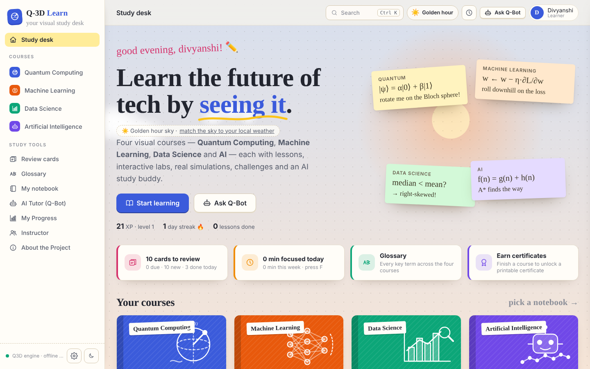

</div>

---

## ✨ What's inside

Every course is a "notebook" with the **same study toolkit**: lessons with formulas and quizzes, hands-on **visual labs** powered by real Python computation, auto-graded **challenges**, a context-aware **AI tutor** and **progress tracking**.

| Course | Lessons | Visual labs (all computed in Python) | Challenges |
|---|---|---|---|
| ⚛️ **Quantum Computing** | 8 — qubits → Grover | **3D Bloch sphere** with animated gate rotations · **Circuit builder** (drag & drop, statevector + Qiskit Aer, Q-sphere, step-through, OpenQASM/Qiskit code) · **Algorithm library** (Bell, GHZ, teleportation, Deutsch–Jozsa, Bernstein–Vazirani, Grover, QFT) | 9 state-preparation puzzles graded by fidelity |
| 🧠 **Machine Learning** | 7 — intro → overfitting | **Regression & gradient descent** with a **3D loss landscape** and degree sweep · **Classifier playground** (logistic regression, k-NN, decision tree, neural network) with live decision boundaries, network-weight and tree diagrams · **k-means** step-through with elbow & silhouette | 6 (tune η, tiny network, spiral, shallow tree, detective questions) |
| 📊 **Data Science** | 6 — lifecycle → CLT | **Data explorer** (table, summary stats, histograms, scatter + trend line, correlation heatmap, group compare) · **Cleaning pipeline** builder with before/after quality · **Probability lab** (distributions + Central Limit Theorem) | 6 (incl. "Data Janitor" pipeline task) |
| 🤖 **Artificial Intelligence** | 7 — agents → responsible AI | **Pathfinding visualiser** (BFS/DFS/UCS/Greedy/A*, paint walls & mud) · **Minimax tic-tac-toe** with move scores and alpha–beta stats · **Q-learning gridworld** (values, policy arrows, reward curve) · **Next-word predictor** (n-gram LM, temperature, token-by-token) | 4 |

Plus, across all courses:

- 🤖 **Q-Bot, the AI study buddy** — answers by text or **voice** (Web Speech API), sees the course you're in and your **latest lab result / circuit**, and shows the facts it was grounded on. Works fully **offline**, or with OpenAI / Gemini / any OpenAI-compatible model (e.g. Ollama).
- 📈 **My Progress** — XP, levels, study streak, per-course progress, topic-mastery radar, learning path, recommendations, experiment history.
- 👩‍🏫 **Instructor dashboard** — classrooms with join codes, all-courses or per-course mastery heatmaps, weak-topic alerts, sortable student table, assignments from any course with completion tracking, one-click demo class.
- 📝 **Study theme** — warm "notebook paper" light theme with highlighter accents, sticky notes and chalkboard panels for 3D/simulations, plus a **night-study dark mode**. Responsive down to phones.

## 📸 Screenshots

| Classifier playground (ML) | 3D loss landscape (ML) |
|---|---|
| 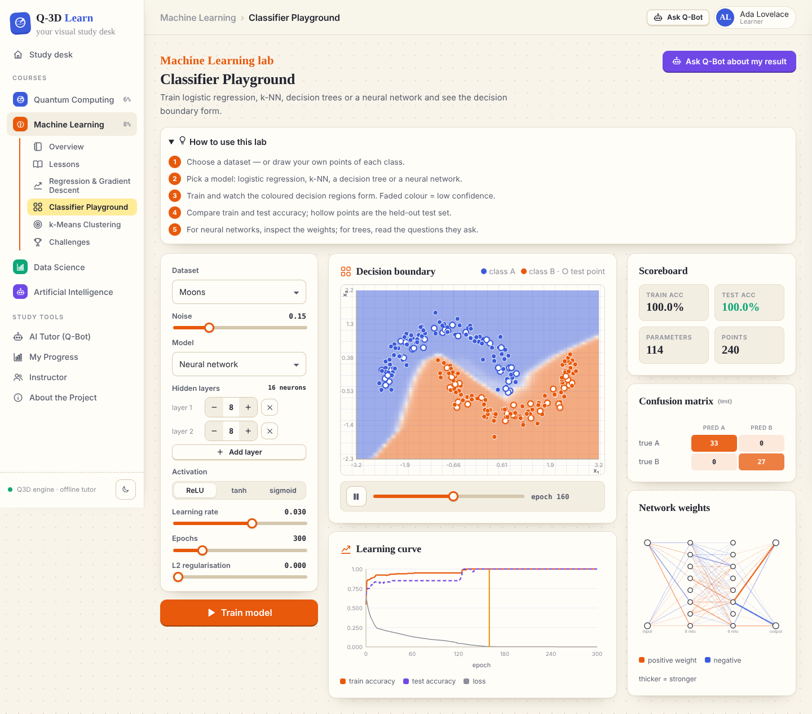 | 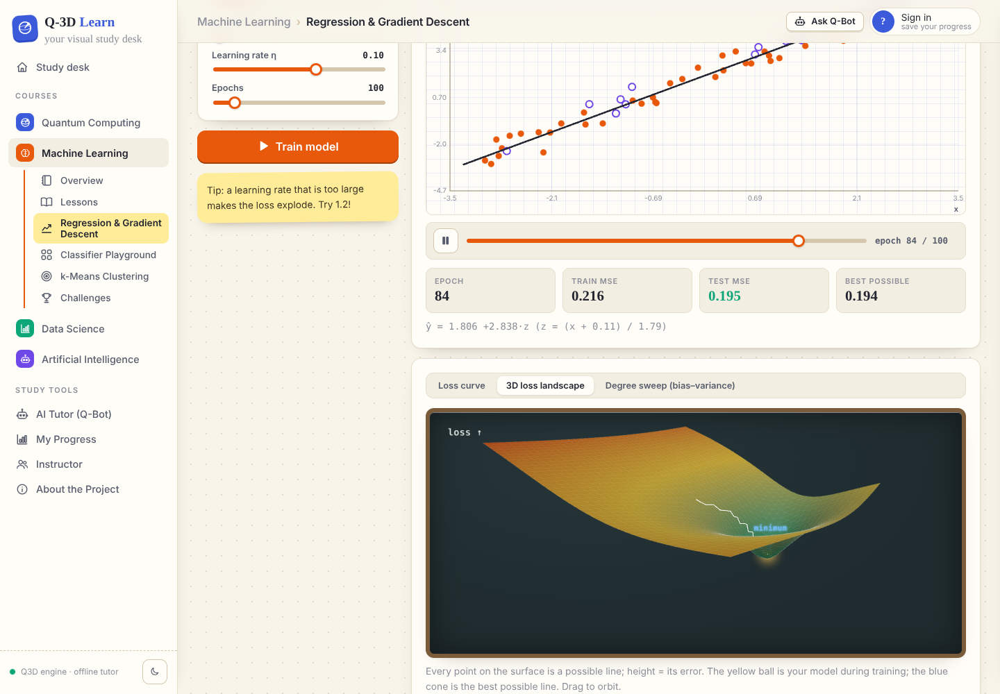 |
| **Cleaning pipeline (Data Science)** | **Pathfinding visualiser (AI)** |
| 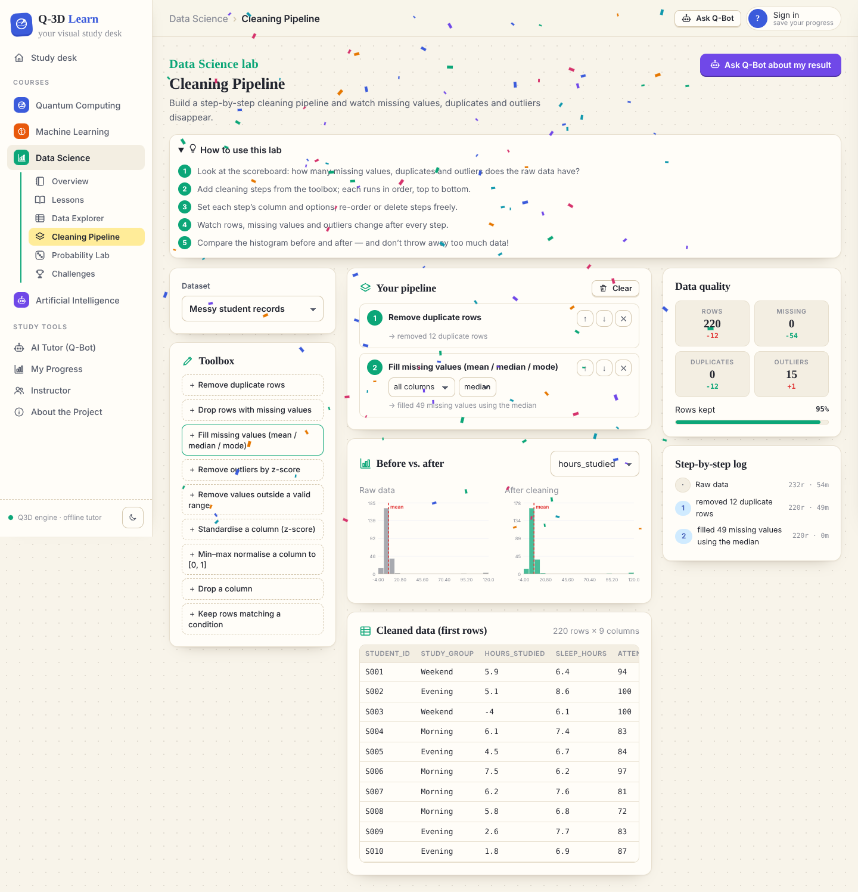 | 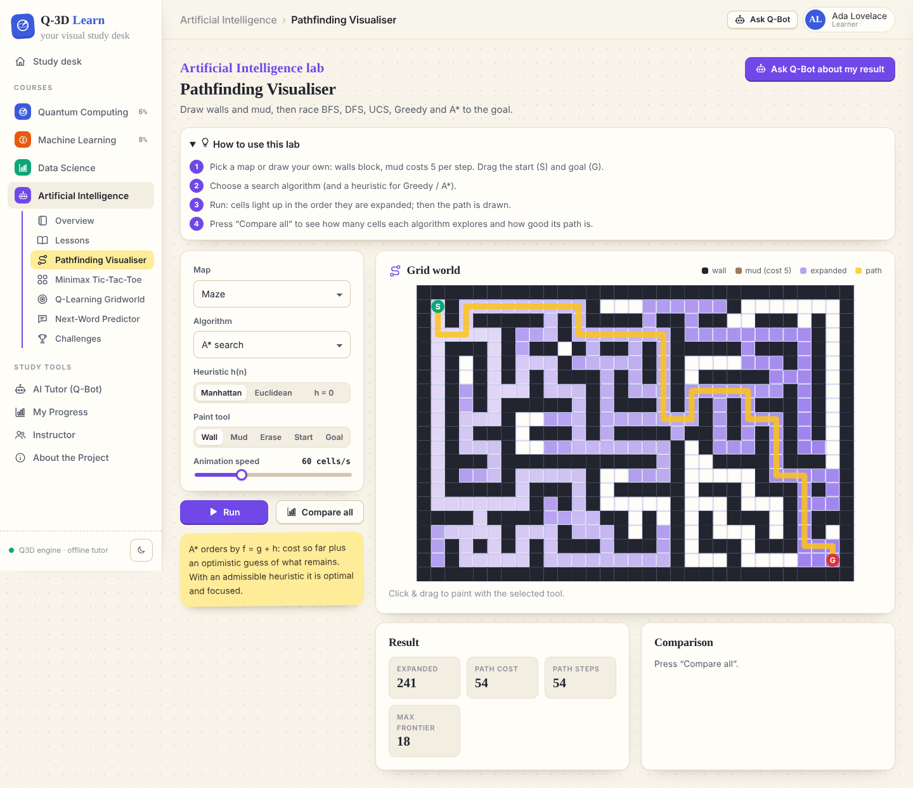 |
| **Q-learning gridworld (AI)** | **Circuit builder (Quantum)** |
| 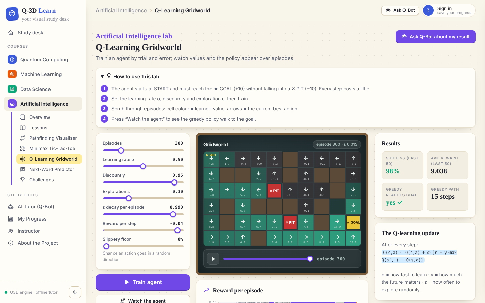 | 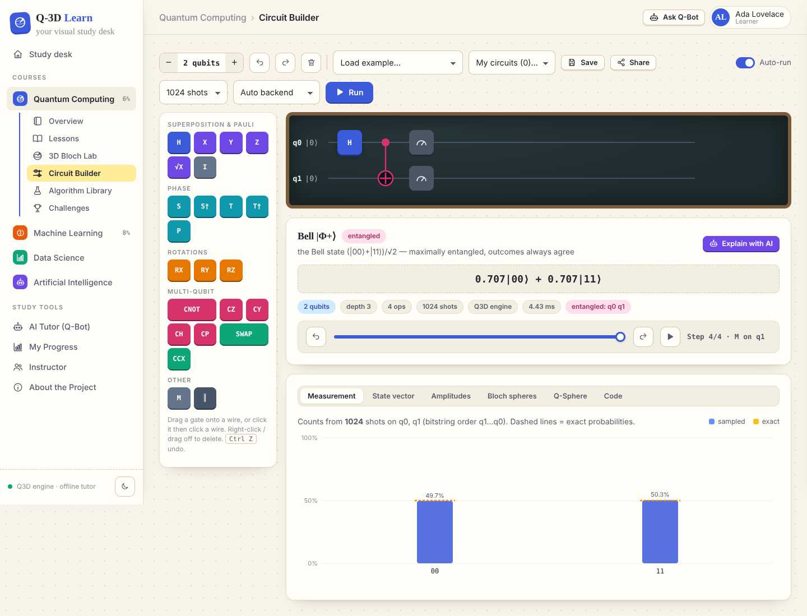 |
| **Lesson with quiz** | **AI tutor grounded on your lab run** |
| 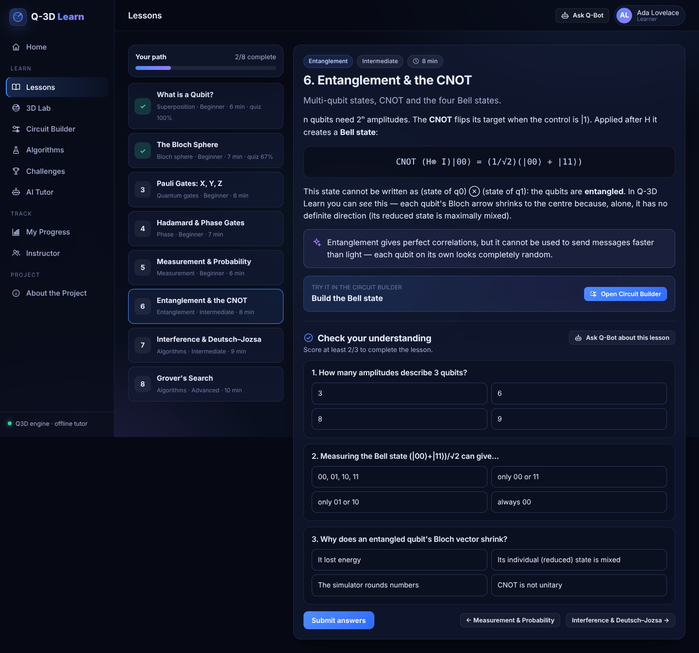 | 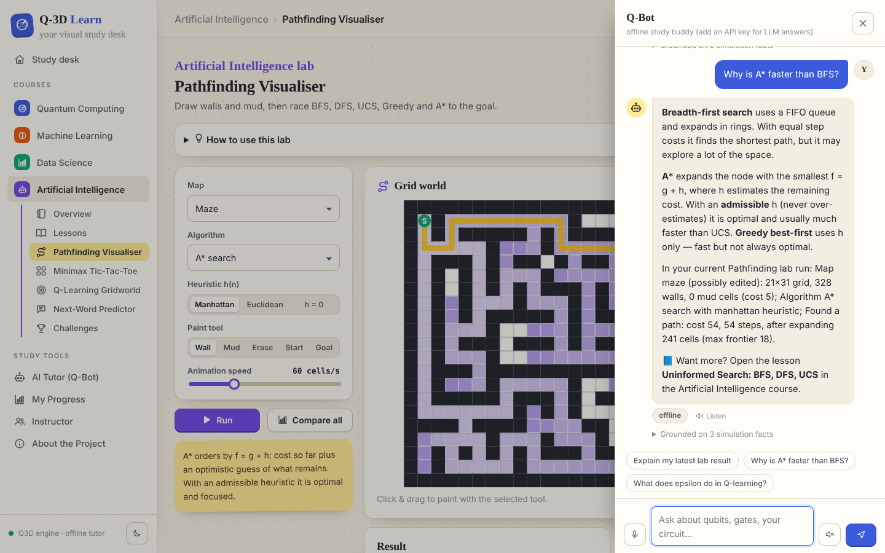 |
| **Instructor dashboard** | **Night-study dark mode** |
| 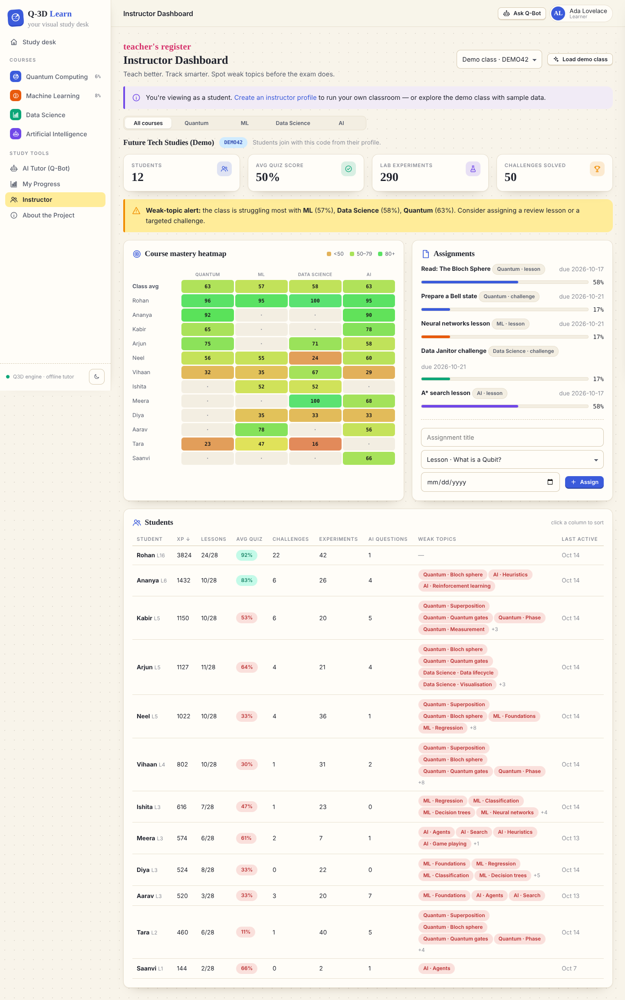 | 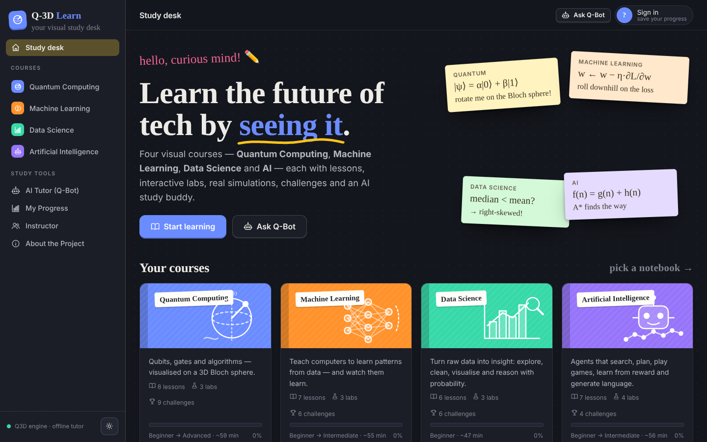 |

More in [`docs/screenshots`](docs/screenshots): data explorer, probability lab, k-means, next-word predictor, Bloch lab, progress page.

## 🚀 Quick start

**Requirements:** Python 3.10+ and a modern browser. No Node.js or build step.

```bash
git clone https://github.com/divya912F/q3d-learn.git
cd q3d-learn
python -m venv .venv
source .venv/bin/activate          # Windows: .venv\Scripts\activate
pip install -r requirements.txt
python run.py
```

Open **http://localhost:8000** — interactive API docs live at **http://localhost:8000/docs**.

> Tip: on the Instructor page click **Load demo class** to explore analytics with 12 sample students across all four courses.

### Optional: AI provider

Q-Bot works out of the box in **offline mode** (validated knowledge base for every course + live analysis of your circuits and lab runs). For free-form LLM answers:

```bash
cp .env.example .env
# then set ONE of:
OPENAI_API_KEY=sk-...
GEMINI_API_KEY=...
# or a local model through Ollama:
AI_PROVIDER=openai
OPENAI_BASE_URL=http://localhost:11434/v1
OPENAI_MODEL=llama3.1
```

### Docker (with PostgreSQL)

```bash
docker compose up --build
```

### Tests

```bash
pip install -r requirements-dev.txt
pytest          # 64 tests: simulators, ML/DS/AI engines, content integrity, API
```

## 🏗️ Architecture

```
Student (browser: laptop / tablet / phone)
        │
Frontend ── ES modules · Three.js (3D) · Canvas/SVG charts · Monaco · KaTeX · Web Speech API     (frontend/)
        │  REST / JSON
Backend  ── FastAPI routers: courses & learning · quantum · labs (ml/ds/ai) · tutor & classrooms   (app/api/)
   ├── Course registry ── quantum · ml · ds · ai  (lessons, quizzes, challenges, tutor knowledge)  (app/courses/)
   ├── Engines         ── quantum statevector + Qiskit Aer      (app/quantum/)
   │                      NumPy ML: GD regression, logistic, k-NN, CART tree, MLP+Adam, k-means   (app/courses/ml/engine.py)
   │                      Data science: datasets, stats, cleaning pipeline, CLT                    (app/courses/ds/engine.py)
   │                      AI: BFS/DFS/UCS/Greedy/A*, minimax+α–β, Q-learning, n-gram LM           (app/courses/ai/engine.py)
   ├── AI tutor        ── grounding (circuit + lab facts + validated notes) → OpenAI | Gemini | offline   (app/ai/)
   └── Analytics       ── per-course XP, mastery, streaks, recommendations, class overview         (app/services/)
        │
Database ── SQLAlchemy 2 → SQLite (default) or PostgreSQL                                          (app/database.py)
```

```
q3d-learn/
├── app/
│   ├── main.py · config.py · database.py · schemas.py
│   ├── api/            learning.py · quantum.py · labs.py · community.py
│   ├── courses/        registry.py + quantum/ · ml/ · ds/ · ai/  (content.py + engine.py each)
│   ├── quantum/        gates · simulator · analysis · validation · qasm · qiskit_runner · algorithms
│   ├── ai/tutor.py     LLM providers + grounding + offline tutor
│   └── services/       progress.py (analytics) · demo.py
├── frontend/
│   ├── index.html · css/main.css (study theme, light + dark)
│   ├── js/views/       home · course · learn · labview · challenges · tutor · progress · instructor · about · quantum views
│   ├── js/labs/        ml-regression · ml-classifier · ml-kmeans · ds-explorer · ds-pipeline · ds-stats · ai-search · ai-minimax · ai-rl · ai-nlp
│   ├── js/three/       bloch.js · qsphere.js · landscape.js
│   ├── js/circuit/     editor.js · results.js · code.js
│   └── vendor/three/   Three.js (bundled so 3D works offline)
├── tests/              test_simulator.py · test_courses.py · test_api.py
└── Dockerfile · docker-compose.yml · .github/workflows/ci.yml
```

### How the AI tutor stays accurate

1. **Grounded facts.** Every question is sent with facts the platform computed itself — the re-simulated quantum circuit, or the numbers from your latest lab run (accuracy, losses, path costs, statistics…).
2. **Validated notes.** Concept explanations come from a curated knowledge base per course and are injected into the LLM prompt.
3. **Offline fallback.** With no API key (or if the provider fails) a deterministic tutor answers from the same facts. Every answer shows what it was grounded on.

### Accuracy of the visuals

All visuals are driven by real computation, never canned animations: the quantum views use an exact statevector simulator (Qiskit bit order, Qiskit Aer counts when installed); ML labs train real models with NumPy and record checkpoints; data-science charts come from the actual dataset statistics; AI labs replay the exact expansion order, minimax scores and Q-tables. The test suite checks known results (e.g. every quantum algorithm's outcome, A* optimality, the CLT standard error).

## 🔌 API overview

| Method | Endpoint | Purpose |
|---|---|---|
| `GET` | `/api/courses` · `/api/courses/{course}` | Course catalogue and details |
| `GET` | `/api/courses/{course}/lessons[/{id}]` | Lessons (quiz answers stay server-side) |
| `POST` | `/api/courses/{course}/lessons/{id}/quiz` | Grade a quiz |
| `POST` | `/api/courses/{course}/challenges/{id}/check` | Check a challenge (circuit, lab config or answer) |
| `POST` | `/api/simulate` · `/api/qasm/export` · `/api/qasm/import` | Quantum simulation and code |
| `POST` | `/api/ml/regression` · `/api/ml/classifier` · `/api/ml/kmeans` | ML labs |
| `POST` | `/api/ds/explore` · `/api/ds/pipeline` · `/api/ds/sample` · `/api/ds/clt` | Data-science labs |
| `POST` | `/api/ai/search` · `/api/ai/minimax` · `/api/ai/qlearn` · `/api/ai/lm` | AI labs |
| `POST` | `/api/tutor/ask` | AI tutor (`course`, `circuit`, `lab` context) |
| `GET` | `/api/progress/{user_id}` | XP, streak, per-course progress, recommendations |
| `GET` | `/api/classrooms/{code}/overview?course=all\|ml\|…` | Instructor analytics |

```bash
curl -X POST localhost:8000/api/ml/classifier -H "Content-Type: application/json" \
  -d '{"config": {"dataset": "moons", "model": "mlp", "hidden": [8, 8], "epochs": 300}}'
```

## ➕ Adding a course

1. Create `app/courses/<id>/content.py` with `COURSE`, `LESSONS`, `CHALLENGES`, `check_challenge()` and `KNOWLEDGE` (copy an existing course).
2. Optionally add an `engine.py` and endpoints in `app/api/labs.py`.
3. Register it in `app/courses/registry.py`, add a colour `--c-<id>` in `frontend/css/main.css`, and lab modules in `frontend/js/views/labview.js`.
4. `pytest` checks the content integrity automatically.

## 🗺️ Roadmap

- [ ] More courses: Cybersecurity, Cloud, Blockchain
- [ ] Noise models and real IBM Quantum hardware runs
- [ ] CNN / image-classifier lab, transformer attention visualiser
- [ ] Multilingual content (Hindi first)
- [ ] Password / SSO authentication and LMS (LTI) integration

## 🤝 Contributing

Contributions are welcome — see [CONTRIBUTING.md](CONTRIBUTING.md). Good first issues: new lessons or challenges in any `app/courses/*/content.py`, new datasets in `app/courses/ds/engine.py`, new mazes in `app/courses/ai/engine.py`.

## 📚 References

- SIH26140 – AI-Based Interactive Quantum Algorithm Learning Platform — https://sih2026.vuce.in/ps/SIH26140
- IBM Quantum Learning — Bits, Gates and Circuits — https://quantum.cloud.ibm.com/learning/en/courses/utility-scale-quantum-computing/bits-gates-and-circuits
- IBM Quantum Learning — Bloch Sphere — https://quantum.cloud.ibm.com/learning/en/courses/general-formulation-of-quantum-information/density-matrices/bloch-sphere
- Qiskit Aer documentation — https://qiskit.github.io/qiskit-aer/
- Qerimi et al. (2025), *Comparing Visual Qubit Representations in Quantum Education: The Bloch Sphere Enhances Task Efficiency* — https://arxiv.org/abs/2507.21721

## 📄 License

[MIT](LICENSE) © 2026 Team SRIJAN. Three.js is bundled under its own MIT licence (`frontend/vendor/three/LICENSE`). Datasets are synthetic and generated in code.

<div align="center"><i>“From abstract theory to an interactive lab.”</i></div>
