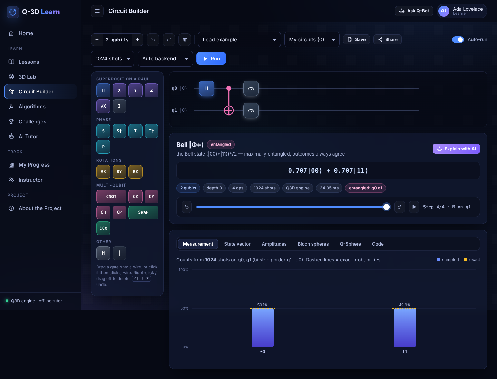
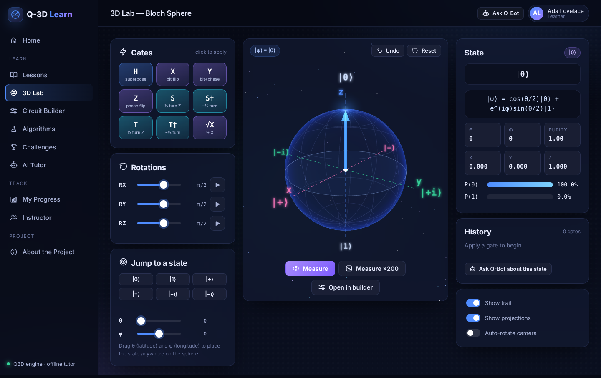
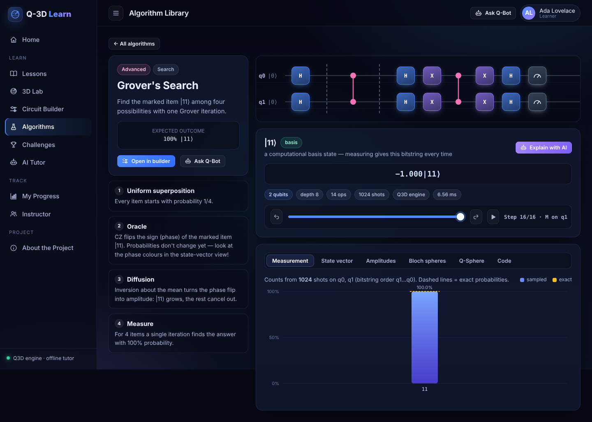
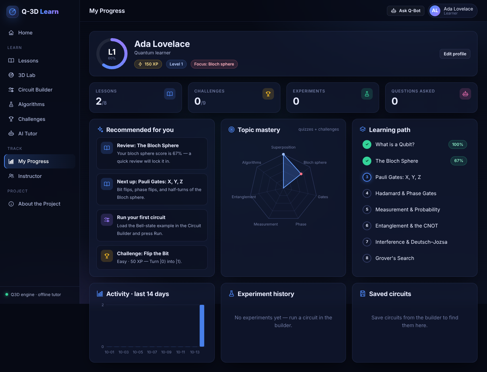

<div align="center">

# ⚛️ Q-3D Learn

### AI-Powered Interactive Quantum Learning Platform

**Making quantum computing _visual_, _interactive_ and _accessible_ to every learner.**

Learn concepts · Build circuits · Simulate & analyse · Ask AI (text + voice) · Experiment & understand

[](.github/workflows/ci.yml)


*Smart India Hackathon 2026 · Problem statement **SIH26140** — AI-Based Interactive Quantum Algorithm Learning Platform · Theme: Smart Education · Team **SRIJAN***


</div>

---

## ✨ What it does

Q-3D Learn is a complete learning experience, not just a simulator. A student moves from **confused → visualise → build → simulate → ask → experiment → master**:

| Section | What you get |
|---|---|
| 📖 **Lessons** | 8-lesson curriculum (qubits → Grover), formulas, insight call-outs, "Try it" buttons that open the lab/builder, server-graded quizzes |
| 🌐 **3D Lab** | Big interactive Bloch sphere: gates animate as real rotations about their axis, θ/φ sliders, trails, projections, measurement with collapse, ×200 shot histogram |
| 🔧 **Circuit Builder** | Drag-and-drop or click-to-place gates (H, X, Y, Z, S, T, √X, RX/RY/RZ, P, CNOT, CZ, CY, CH, CP, SWAP, Toffoli, measure, barrier), parameter editor, undo/redo, save, share links |
| ▶️ **Simulation** | Exact statevector engine + **Qiskit Aer** counts when installed; histogram vs. exact probabilities, state-vector table with phase colours, amplitude circles, per-qubit Bloch spheres, 3D **Q-Sphere**, **step-through slider** that replays the circuit gate by gate |
| 💻 **Code** | OpenQASM 2.0 editor (Monaco) with import ⇄ circuit, plus auto-generated runnable Qiskit Python |
| 🧪 **Algorithms** | Guided walkthroughs: Bell, GHZ, superdense coding, teleportation, Deutsch–Jozsa, Bernstein–Vazirani, Grover, QFT |
| 🏆 **Challenges** | 9 puzzles graded by state **fidelity** (with gate restrictions), hints, XP |
| 🤖 **AI Tutor (Q-Bot)** | Context-aware: sees your current circuit and its *re-computed* simulation results; voice input and read-aloud; works offline, or with OpenAI / Gemini / any OpenAI-compatible model (e.g. Ollama) |
| 📈 **My Progress** | XP & levels, topic-mastery radar, activity, learning path, experiment history, personalised recommendations |
| 👩‍🏫 **Instructor** | Classrooms with join codes, weak-topic heatmap, sortable student analytics, assignments with completion tracking, one-click demo class |
| ℹ️ **About** | The full proposal: idea, architecture, tech stack, feasibility, impact, references |

## 📸 Screenshots

| Circuit builder | 3D Lab |
|---|---|
|  |  |
| **Algorithm walkthrough (Grover)** | **AI tutor grounded on your circuit** |
|  |  |
| **Instructor dashboard** | **Learner progress** |
|  |  |

## 🚀 Quick start

**Requirements:** Python 3.10+ and a modern browser. No Node.js or build step.

```bash
git clone https://github.com/YOUR-USERNAME/q3d-learn.git
cd q3d-learn
python -m venv .venv
source .venv/bin/activate          # Windows: .venv\Scripts\activate
pip install -r requirements.txt
python run.py
```

Open **http://localhost:8000** — interactive API docs are at **http://localhost:8000/docs**.

> Tip: on the Instructor page click **Load demo class** to see analytics with 10 sample students.

### Optional: AI provider

The tutor works out of the box in **offline mode** (validated knowledge base + live circuit analysis). For free-form LLM answers:

```bash
cp .env.example .env
# then set ONE of:
OPENAI_API_KEY=sk-...
GEMINI_API_KEY=...
# or a local model through Ollama:
AI_PROVIDER=openai
OPENAI_BASE_URL=http://localhost:11434/v1
OPENAI_MODEL=llama3.1
```

### Docker (with PostgreSQL)

```bash
docker compose up --build
```

### Tests

```bash
pip install -r requirements-dev.txt
pytest
```

## 🏗️ Architecture

```
Student (browser: laptop / tablet / mobile)
        │
Frontend  ── ES modules + Three.js (3D) + Monaco + KaTeX + Web Speech API   (frontend/)
        │  REST/JSON
Backend   ── FastAPI routers: quantum · learning · community                (app/api/)
   ├── Quantum layer ── Q3D NumPy statevector engine  +  Qiskit Aer           (app/quantum/)
   ├── AI layer      ── context builder → OpenAI | Gemini | offline tutor    (app/ai/)
   ├── Content       ── lessons, quizzes, challenges                         (app/content/)
   └── Analytics     ── XP, mastery, recommendations, class overview         (app/services/)
        │
Database  ── SQLAlchemy 2 → SQLite (default) or PostgreSQL                    (app/database.py)
```

```
q3d-learn/
├── app/
│   ├── main.py            FastAPI app + static frontend
│   ├── config.py          env-driven settings
│   ├── database.py        ORM models
│   ├── schemas.py         request models
│   ├── api/               quantum.py · learning.py · community.py
│   ├── quantum/           gates · simulator · analysis · validation · qasm · qiskit_runner · algorithms
│   ├── ai/                tutor.py (providers + grounding) · knowledge.py
│   ├── content/           lessons.py · challenges.py
│   └── services/          progress.py (analytics) · demo.py
├── frontend/
│   ├── index.html · css/main.css
│   ├── js/three/          bloch.js · qsphere.js · common.js
│   ├── js/circuit/        editor.js · results.js · code.js
│   ├── js/views/          one module per page
│   └── vendor/three/      Three.js (bundled so 3D works offline)
├── tests/                 pytest suite (simulator, algorithms, API)
├── Dockerfile · docker-compose.yml · .github/workflows/ci.yml
```

### How the AI stays accurate

The proposal flagged **AI hallucination** as a key risk. Q-Bot mitigates it by design:

1. Before answering, the backend **re-simulates the learner's circuit** and passes exact facts (state, probabilities, Bloch vectors, entanglement) to the model as authoritative context.
2. Concept explanations come from a **curated knowledge base** that is injected into the prompt.
3. With no key, or if the API fails, a **deterministic offline tutor** answers from the same facts. Every answer shows the facts it was grounded on.

### Simulation accuracy

- Bit ordering follows Qiskit (q0 = least-significant bit, strings printed `q[n-1]…q0`).
- Every result includes the exact pre-measurement statevector; sampled counts come from Qiskit Aer when available.
- Mid-circuit measurement (re-using a measured qubit) switches to shot-by-shot trajectory simulation.
- The test suite checks all 8 library algorithms against their known outcomes.

## 🔌 API overview

| Method | Endpoint | Purpose |
|---|---|---|
| `POST` | `/api/simulate` | Run a circuit (`num_qubits`, `operations`, `shots`, `backend`) |
| `POST` | `/api/qasm/export` · `/api/qasm/import` | OpenQASM 2.0 / Qiskit code |
| `GET` | `/api/algorithms[/{id}]` | Algorithm library |
| `GET` | `/api/lessons[/{id}]` · `POST /api/lessons/{id}/quiz` | Lessons & graded quizzes |
| `GET` | `/api/challenges` · `POST /api/challenges/{id}/check` | Challenges |
| `POST` | `/api/tutor/ask` | AI tutor |
| `GET` | `/api/progress/{user_id}` | XP, mastery, recommendations |
| `POST` | `/api/classrooms` · `GET /api/classrooms/{code}/overview` | Instructor analytics |

Full schema: `/docs` (Swagger) when the server is running.

```bash
curl -X POST localhost:8000/api/simulate -H "Content-Type: application/json" -d '{
  "num_qubits": 2,
  "operations": [{"name": "h", "qubits": [0]}, {"name": "cx", "qubits": [0, 1]}],
  "shots": 1024
}'
```

## 🗺️ Roadmap

- [ ] Noise models (real-device noise via Qiskit Aer)
- [ ] Run on real IBM Quantum hardware
- [ ] More lessons (phase estimation, Shor, VQE) and multilingual content (Hindi first)
- [ ] Password / SSO authentication for institutions
- [ ] LMS integration (LTI)

## 🤝 Contributing

Contributions are welcome — see [CONTRIBUTING.md](CONTRIBUTING.md). Good first issues: new lessons in `app/content/lessons.py`, new challenges, new algorithms in `app/quantum/algorithms.py`.

## 📚 References

- SIH26140 – AI-Based Interactive Quantum Algorithm Learning Platform — https://sih2026.vuce.in/ps/SIH26140
- IBM Quantum Learning — Bits, Gates and Circuits — https://quantum.cloud.ibm.com/learning/en/courses/utility-scale-quantum-computing/bits-gates-and-circuits
- IBM Quantum Learning — Bloch Sphere — https://quantum.cloud.ibm.com/learning/en/courses/general-formulation-of-quantum-information/density-matrices/bloch-sphere
- Qiskit Aer documentation — https://qiskit.github.io/qiskit-aer/
- Qerimi et al. (2025), *Comparing Visual Qubit Representations in Quantum Education: The Bloch Sphere Enhances Task Efficiency* — https://arxiv.org/abs/2507.21721

## 📄 License

[MIT](LICENSE) © 2026 Team SRIJAN. Three.js is bundled under its own MIT licence (`frontend/vendor/three/LICENSE`).

<div align="center"><i>“From abstract theory to an interactive quantum lab.”</i></div>
