<div align="center">

# ⚛️ Q-3D Learn

### Your visual study desk for the future of tech

**Eight interactive courses — Quantum Computing · Machine Learning · Data Science · Artificial Intelligence · Data Structures & Algorithms · Cybersecurity & Cryptography · Blockchain · Deep Learning & Computer Vision**
<br>Learn concepts · Play with visual labs · Run real computations · Ask an AI tutor (text + voice) · Review with spaced repetition · Study under a living sky · Works offline

[](.github/workflows/ci.yml)


*Smart India Hackathon 2026 · Problem statement **SIH26140** — AI-Based Interactive Algorithm Learning Platform · Theme: Smart Education · Team **SRIJAN***


</div>

---

## ✨ What's inside

Every course is a "notebook" with the **same study toolkit**: lessons with formulas and quizzes, hands-on **visual labs** powered by real Python computation, auto-graded **challenges**, a context-aware **AI tutor** and **progress tracking**.

| Course | Lessons | Visual labs (all computed in Python) | Challenges |
|---|---|---|---|
| ⚛️ **Quantum Computing** | 18 — qubits → error correction & Shor | **3D quantum walk landscape** (ridgeline of probability over time vs a classical walker, with decoherence) · **3D Bloch sphere** with animated gate rotations · **Circuit builder** (drag & drop, statevector + Qiskit Aer, Q-sphere, step-through, OpenQASM/Qiskit code) · **Algorithm library** (Bell, GHZ, teleportation, Deutsch–Jozsa, Bernstein–Vazirani, Grover, QFT) | 9 state-preparation puzzles graded by fidelity |
| 🧠 **Machine Learning** | 18 — intro → SVMs, ensembles & MLOps | **Regression & gradient descent** with a **3D loss landscape** and degree sweep · **Classifier playground** (logistic regression, k-NN, decision tree, neural network) with live decision boundaries, network-weight and tree diagrams · **k-means** step-through with elbow & silhouette | 6 (tune η, tiny network, spiral, shallow tree, detective questions) |
| 📊 **Data Science** | 17 — lifecycle → A/B tests, time series & ethics | **Data explorer** (table, summary stats, histograms, scatter + trend line, correlation heatmap, group compare) · **Cleaning pipeline** builder with before/after quality · **Probability lab** (distributions + Central Limit Theorem) | 6 (incl. "Data Janitor" pipeline task) |
| 🤖 **Artificial Intelligence** | 17 — agents → MDPs, transformers & alignment | **Pathfinding visualiser** (BFS/DFS/UCS/Greedy/A*, paint walls & mud) · **Minimax tic-tac-toe** with move scores and alpha–beta stats · **Q-learning gridworld** (values, policy arrows, reward curve) · **Next-word predictor** (n-gram LM, temperature, token-by-token) | 4 |
| 🧩 **Data Structures & Algorithms** | 17 — Big-O → DP, greedy & interview patterns (Java snippets) | **Sorting race** (6 algorithms side by side, spotlight, *sound of sorting*, growth chart) · **Graph explorer** (BFS/DFS/Dijkstra/Prim/Kruskal on a glowing constellation) · **Tree garden** (BST vs AVL with animated rotations) | 4 (beat 200 comparisons, Dijkstra cost, AVL height…) |
| 🔐 **Cybersecurity & Cryptography** | 17 — CIA triad → web, network, PKI & incident response | **Cipher wheel** (Caesar/Vigenère/XOR with χ² and index-of-coincidence cracking) · **Hash avalanche** (bit-flip heatmap, password-strength meter) · **RSA & Diffie–Hellman workshop** (extended Euclid, square-and-multiply trace) | 4 (crack Caesar & Vigenère, find *d*, build a strong password) |
| ⛓️ **Blockchain** | 16 — hashing → PoS, DeFi, scaling & contract security | **3D chain & live SHA-256 miner** (tamper a block, watch the chain break, re-mine it) · **Merkle tree** with inclusion proofs · **51% attack race** (simulated double spends vs Nakamoto's whitepaper formula) | 4 |
| 👁️ **Deep Learning & Computer Vision** | 17 — the neuron → transformers, diffusion & transfer learning | **Convolution lab** (kernel slides over the image, feature maps, pooling) · **Attention lens** (glowing token-to-token arcs, multiple heads) · **Dream machine** (gradient-ascent feature visualisation, kaleidoscope mode, neuron zoo, save as PNG) | 4 |

Plus, across all courses:

- 🤖 **Q-Bot, the AI study buddy** — answers by text or **voice** (Web Speech API), sees the course you're in and your **latest lab result / circuit**, and shows the facts it was grounded on. Works fully **offline**, or with OpenAI / Gemini / any OpenAI-compatible model (e.g. Ollama).
- 📈 **My Progress** — XP, levels, study streak, per-course progress, topic-mastery radar, learning path, recommendations, experiment history.
- 👩‍🏫 **Instructor dashboard** — classrooms with join codes, all-courses or per-course mastery heatmaps, weak-topic alerts, sortable student table, assignments from any course with completion tracking, one-click demo class.
- 📝 **Study theme** — warm "notebook paper" light theme with highlighter accents, sticky notes and chalkboard panels for 3D/simulations, plus a **night-study dark mode**. Responsive down to phones.

### 🆕 New in v2.3 — a full curriculum + career roadmaps

- **137 lessons across 8 courses** — every course now runs from the absolute basics to advanced topics (**15–20 lessons each**), with formulas, quizzes and "try it in the lab" links throughout.
- **Career roadmaps** — each course ends with a **"Where this takes you"** section: the roles you can grow into (with demand indicators), a four-stage learning ladder, projects to build, and which course to take next.
- **190+ glossary terms & 450+ spaced-repetition flashcards**, generated from the expanded knowledge base.

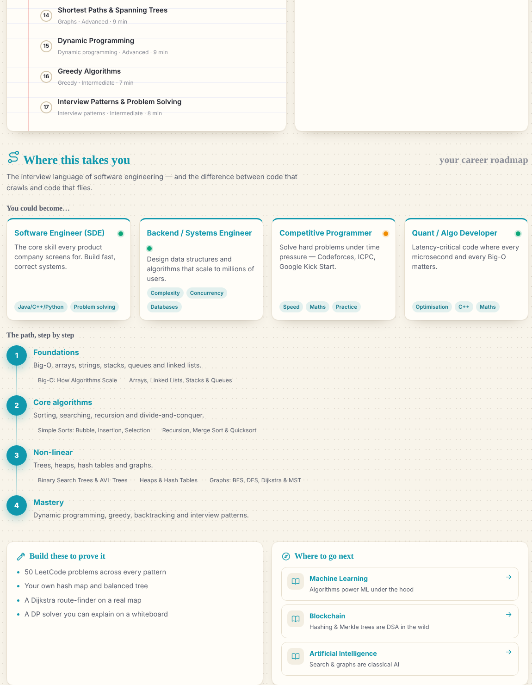

### 🆕 New in v2.2 — four new courses and neon labs

- **4 new courses** (DSA, Cybersecurity & Cryptography, Blockchain, Deep Learning & Computer Vision): **27 new lessons**, **16 new challenges**, tutor knowledge, flashcards and glossary terms for each.
- **13 new visual labs** in a shared neon toolkit (`frontend/js/labs/neon.js`): glowing space backgrounds, additive light trails, two new Three.js scenes (`chain3d.js`, `walk3d.js`), all driven by real computation in Python (sorting event traces, SHA-256 proof-of-work, Merkle proofs, RSA arithmetic, convolutions, attention weights, gradient ascent).
- **Quantum walk** lab and lesson added to the quantum course.

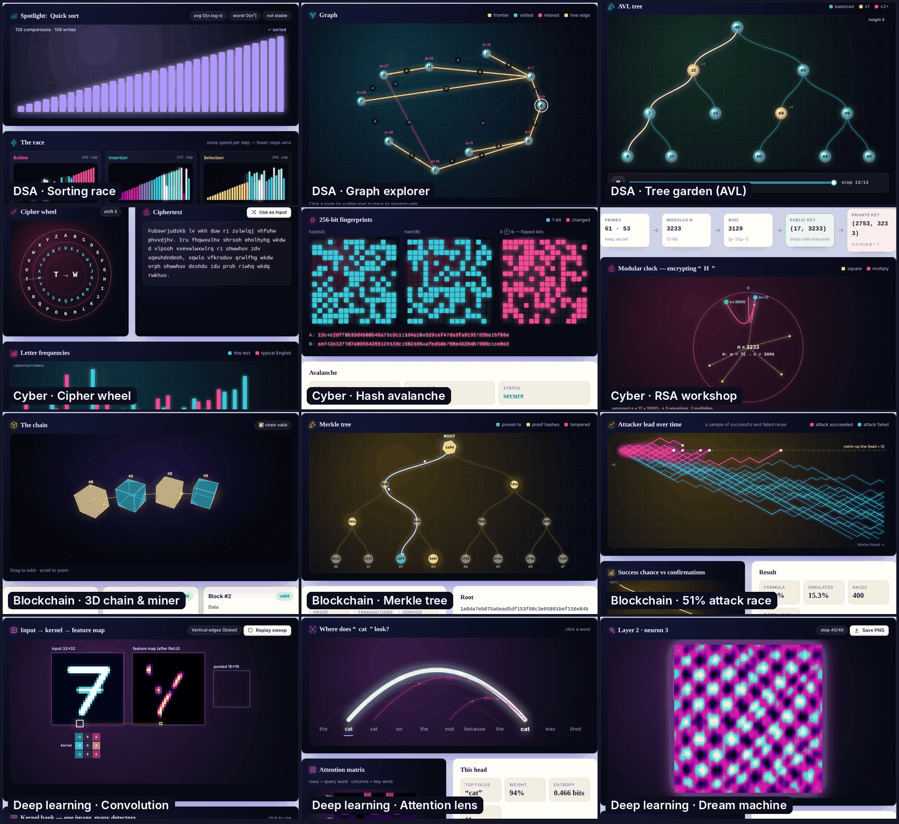

### 🆕 New in v2.1 — study smarter, not longer

| Feature | What it does | Why (research) |
|---|---|---|
| 🌤️ **Living sky** | An animated sky behind your desk that follows **your time of day** (dawn → golden hour → night) and, if you opt in, **your real local weather** (Open-Meteo, no account). Or pick a mood: rain, snow, storm, fog, aurora, *quantum night* (floating qubits in the course colour). Optional generated ambient sound: soft rain, brown noise, ocean waves. | A calm, personal study space; colours are blended with the theme so text stays readable, and it pauses for reduced-motion users. |
| 🃏 **Review cards (spaced repetition)** | Every quiz question and key concept becomes a flashcard (**150+ cards**). Anki-style *Again / Hard / Good / Easy* buttons with the **SM-2** scheduler; due-card badge in the sidebar; guest practice mode. | Retrieval practice and spacing are among the most robust findings in learning science. |
| ⏳ **Focus timer** | Pomodoro blocks (25/5, 50/10, 15/3) that survive page changes, chime when done and log minutes to your XP and streak. Press **F** anywhere. | Short, protected focus blocks reduce task-switching. |
| 🔤 **Glossary + in-lesson definitions** | 118 terms across all eight courses. Key words in lessons are underlined — tap one for its definition without leaving the page. | A low-barrier "bridge" for learners missing background vocabulary. |
| ✏️ **My notebook** | A notes box beside every lesson (auto-saved to your profile, or this browser for guests), collected on one page and exportable to Markdown. | Summarising in your own words improves recall. |
| 🔎 **Command palette** | **Ctrl/⌘ + K** (or **/**) searches every lesson, lab, challenge, glossary term and action. | Faster navigation for a big curriculum. |
| 🏅 **Certificates** | Finish every lesson with a 60%+ quiz average to unlock a printable certificate with a verification code (`#/certificate/verify/<code>`). | Recognisable milestones for students and instructors. |
| 📲 **Installable & offline (PWA)** | Install on phones and laptops; the whole app shell is cached and pages you opened keep working with no internet. | Designed for patchy connectivity and low-end devices. |
| ♿ **Accessibility settings** | Text size (4 steps), reduced motion, high contrast and a readable font (Lexend). | Open and inclusive by default. |

## 📸 Screenshots

| Classifier playground (ML) | 3D loss landscape (ML) |
|---|---|
|  |  |
| **Cleaning pipeline (Data Science)** | **Pathfinding visualiser (AI)** |
|  |  |
| **Q-learning gridworld (AI)** | **Circuit builder (Quantum)** |
|  |  |
| **Lesson with quiz** | **AI tutor grounded on your lab run** |
|  |  |
| **Instructor dashboard** | **Night-study dark mode** |
|  |  |
| **Sorting race (DSA)** | **Graph explorer (DSA)** |
| 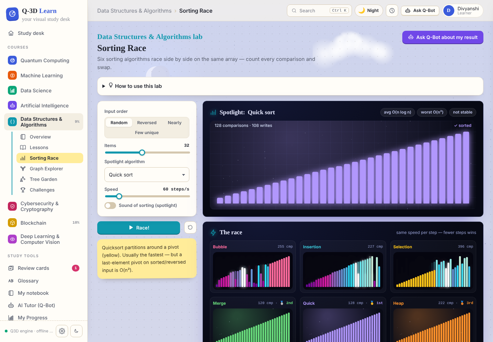 | 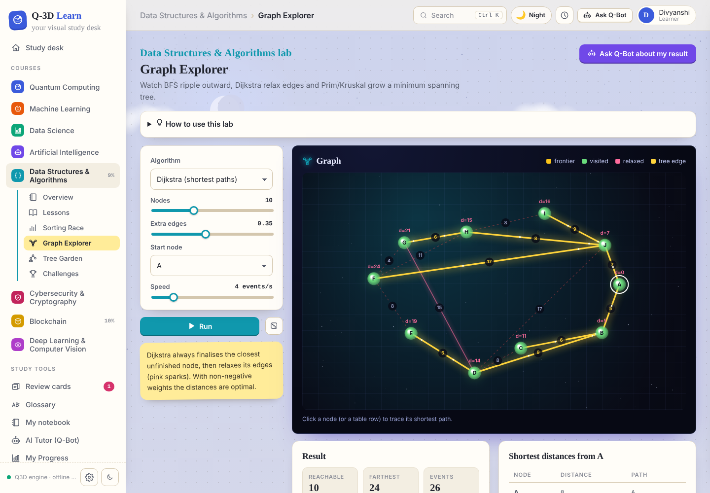 |
| **3D chain & miner (Blockchain)** | **Cipher wheel (Cyber)** |
| 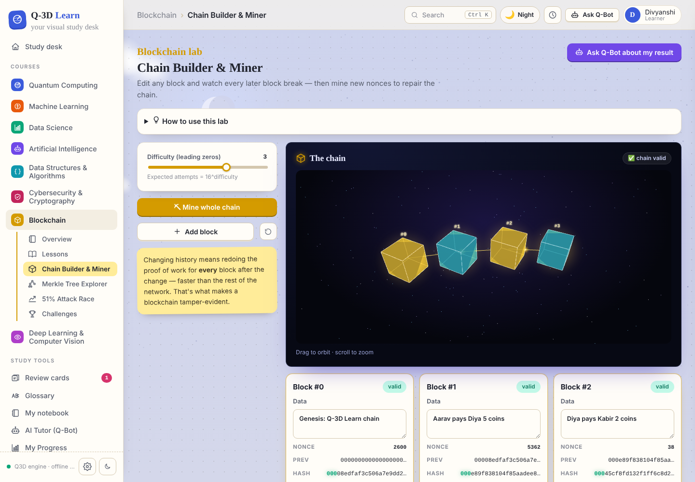 | 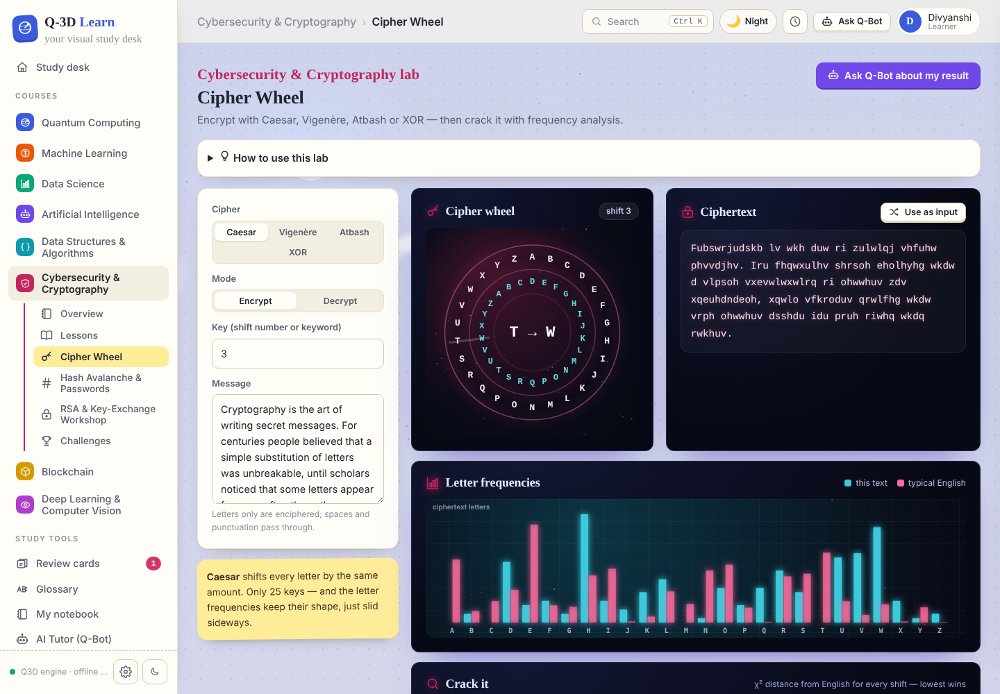 |
| **Dream machine (Deep learning)** | **Quantum walk (Quantum)** |
| 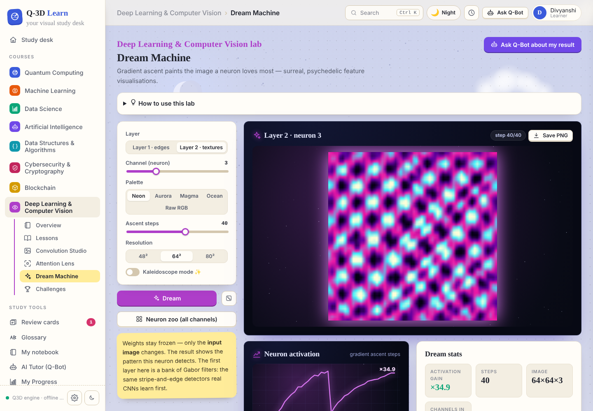 | 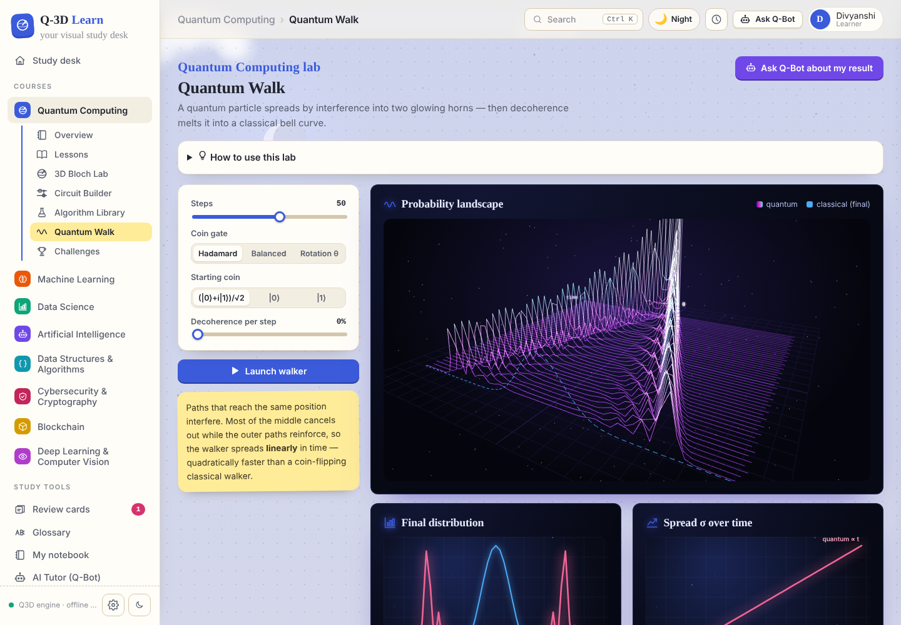 |
| **Career roadmap (every course)** | **15–20 lessons per course** |
|  | 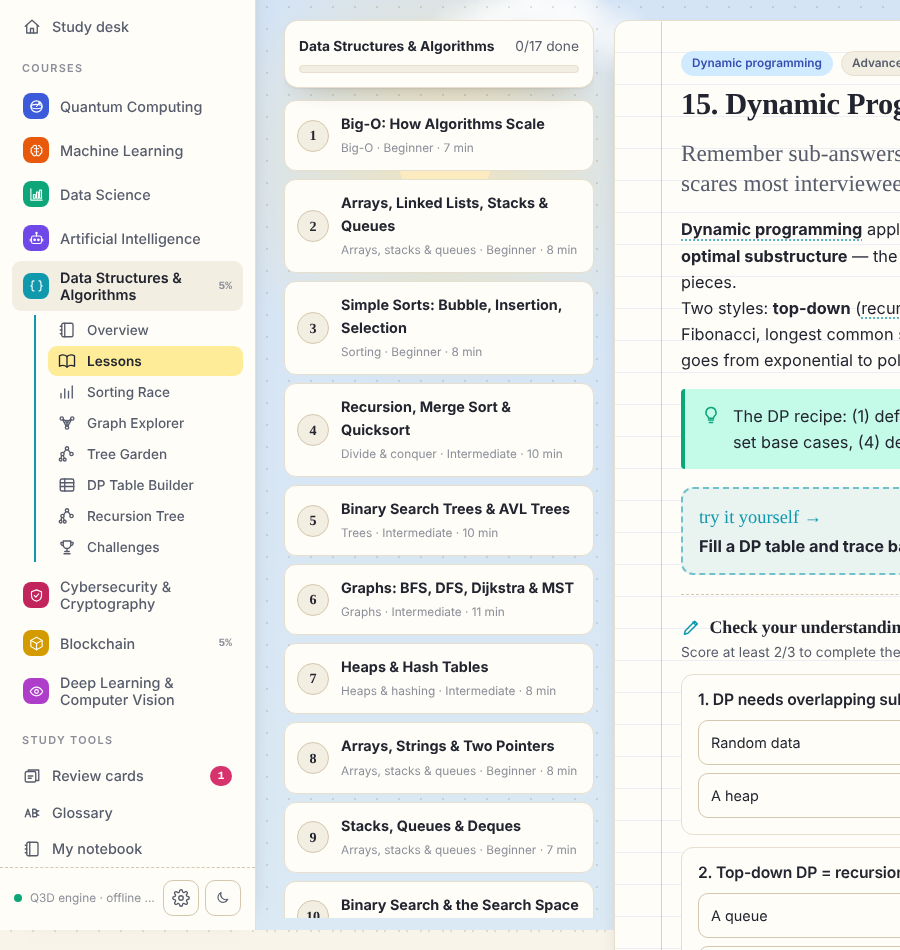 |

| **Living sky — time of day, weather and moods** | |
| 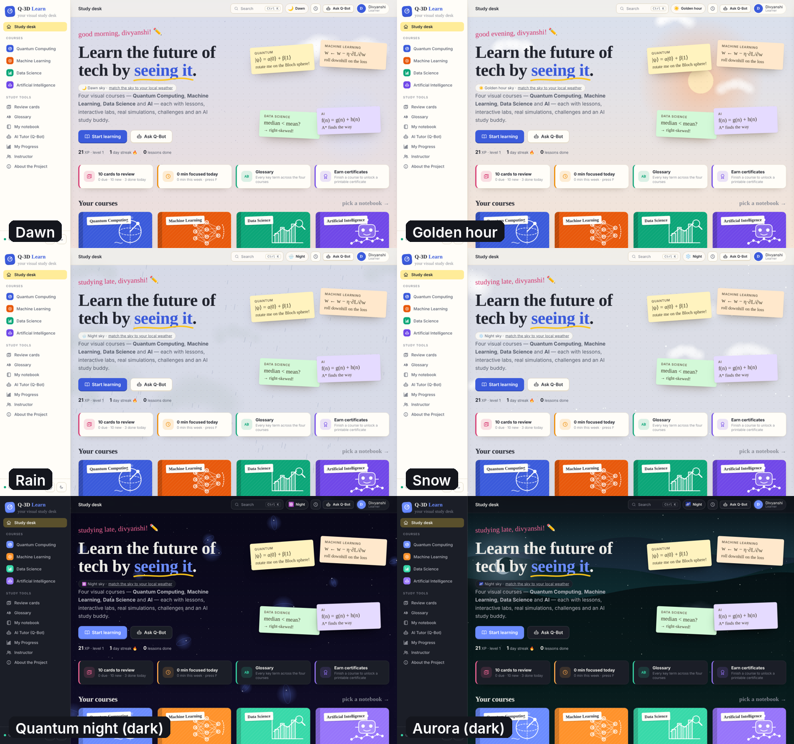 | |
| **Review cards (spaced repetition)** | **Glossary terms inside lessons** |
| 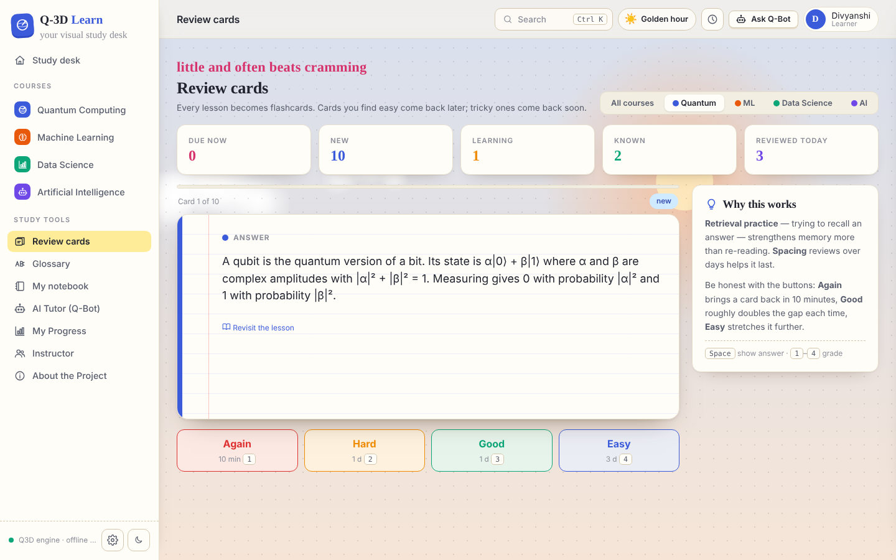 | 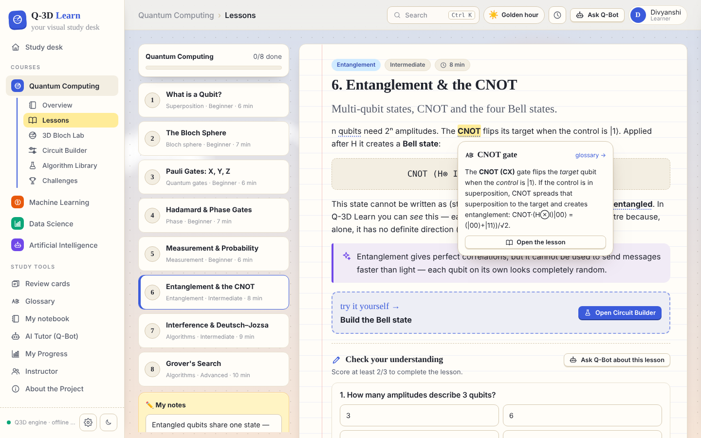 |
| **Command palette (Ctrl + K)** | **Focus timer** |
| 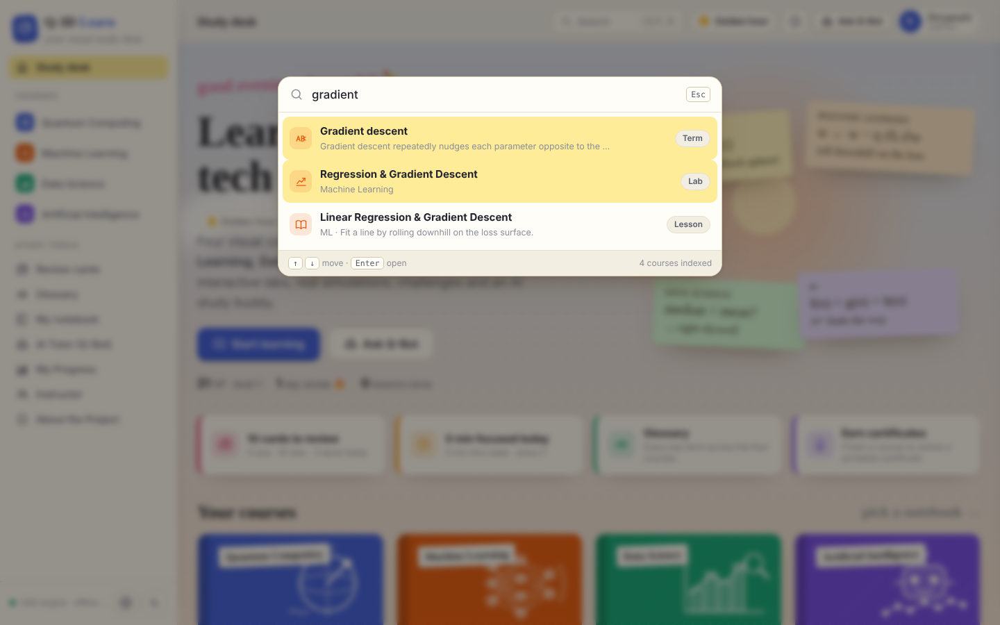 | 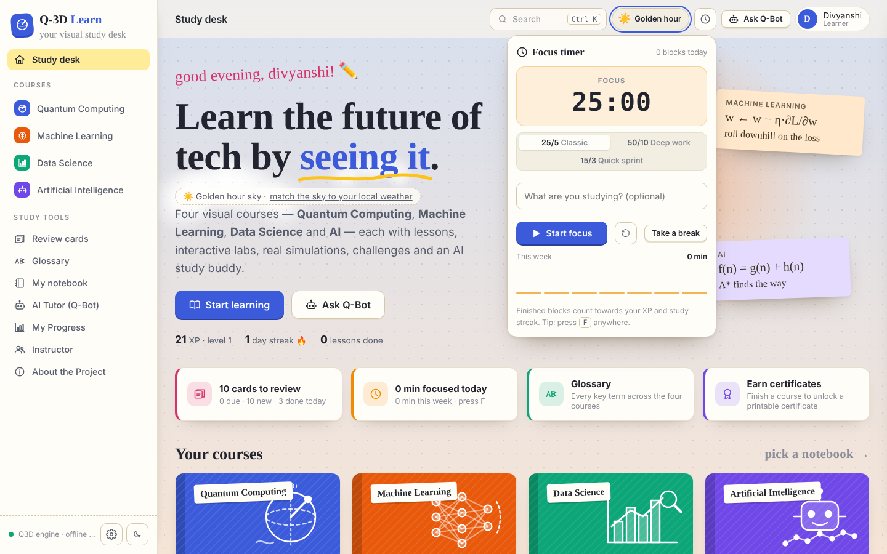 |

More in [`docs/screenshots`](docs/screenshots): glossary, sky settings panel, data explorer, probability lab, k-means, next-word predictor, Bloch lab, progress page.

## 🚀 Quick start

**Requirements:** Python 3.10+ and a modern browser. No Node.js or build step.

```bash
git clone https://github.com/divya912F/q3d-learn.git
cd q3d-learn
python -m venv .venv
source .venv/bin/activate          # Windows: .venv\Scripts\activate
pip install -r requirements.txt
python run.py
```

Open **http://localhost:8000** — interactive API docs live at **http://localhost:8000/docs**.

> Tip: on the Instructor page click **Load demo class** to explore analytics with 12 sample students across all eight courses.

### Optional: AI provider

Q-Bot works out of the box in **offline mode** (validated knowledge base for every course + live analysis of your circuits and lab runs). For free-form LLM answers:

```bash
cp .env.example .env
# then set ONE of:
OPENAI_API_KEY=sk-...
GEMINI_API_KEY=...
# or a local model through Ollama:
AI_PROVIDER=openai
OPENAI_BASE_URL=http://localhost:11434/v1
OPENAI_MODEL=llama3.1
```

### Docker (with PostgreSQL)

```bash
docker compose up --build
```

### Tests

```bash
pip install -r requirements-dev.txt
pytest          # 116 tests: simulators, all course engines, content integrity, API, spaced repetition, offline app shell
                # 8 courses · 137 lessons · 37 labs · career roadmaps
```

## 🏗️ Architecture

```
Student (browser: laptop / tablet / phone)
        │
Frontend ── ES modules · Three.js (3D) · Canvas/SVG charts · Monaco · KaTeX · Web Speech/Audio API · living-sky canvas · service worker (frontend/)
        │  REST / JSON
Backend  ── FastAPI routers: courses & learning · quantum · labs (ml/ds/ai/dsa/cyber/chain/dl) · tutor & classrooms   (app/api/)
   ├── Course registry ── quantum · ml · ds · ai · dsa · cyber · chain · dl  (lessons, quizzes, challenges, tutor knowledge)  (app/courses/)
   ├── Engines         ── quantum statevector + Qiskit Aer      (app/quantum/)
   │                      NumPy ML: GD regression, logistic, k-NN, CART tree, MLP+Adam, k-means   (app/courses/ml/engine.py)
   │                      Data science: datasets, stats, cleaning pipeline, CLT                    (app/courses/ds/engine.py)
   │                      AI: BFS/DFS/UCS/Greedy/A*, minimax+α–β, Q-learning, n-gram LM           (app/courses/ai/engine.py)
   │                      DSA: sorting traces, graph algorithms, BST/AVL                           (app/courses/dsa/engine.py)
   │                      Cyber: classical ciphers + cracking, hashing, RSA, Diffie–Hellman         (app/courses/cyber/engine.py)
   │                      Blockchain: SHA-256 PoW mining, Merkle proofs, double-spend race         (app/courses/chain/engine.py)
   │                      Deep learning: conv2d, pooling, attention, feature visualisation         (app/courses/dl/engine.py)
   ├── AI tutor        ── grounding (circuit + lab facts + validated notes) → OpenAI | Gemini | offline   (app/ai/)
   ├── Study tools     ── flashcard deck + SM-2, glossary, focus sessions, notes, certificates   (app/services/study.py)
   └── Analytics       ── per-course XP, mastery, streaks, recommendations, class overview         (app/services/)
        │
Database ── SQLAlchemy 2 → SQLite (default) or PostgreSQL                                          (app/database.py)
```

```
q3d-learn/
├── app/
│   ├── main.py · config.py · database.py · schemas.py
│   ├── api/            learning.py · quantum.py · labs.py · community.py · study.py
│   ├── courses/        registry.py + roadmaps.py + quantum/ · ml/ · ds/ · ai/ · dsa/ · cyber/ · chain/ · dl/  (content.py + extra.py lessons + engine.py + more_labs.py)
│   ├── quantum/        gates · simulator · analysis · validation · qasm · qiskit_runner · algorithms · walk
│   ├── ai/tutor.py     LLM providers + grounding + offline tutor
│   └── services/       progress.py (analytics) · study.py (flashcards, SM-2, glossary) · demo.py
├── frontend/
│   ├── index.html · css/main.css (study theme, light + dark) · sw.js + manifest (offline app)
│   ├── js/sky.js       living sky (time of day, live weather, moods, ambient sound)
│   ├── js/study/       focus timer · command palette · glossary tips · notes · settings
│   ├── js/views/       home · course · learn · labview · challenges · review · glossary · notes · certificate · tutor · progress · instructor · about · quantum views
│   ├── js/labs/        ml-regression · ml-classifier · ml-kmeans · ds-explorer · ds-pipeline · ds-stats · ai-search · ai-minimax · ai-rl · ai-nlp · dsa-* · cy-* · bc-* · dl-* · q-walk · neon.js (shared glow toolkit)
│   ├── js/three/       bloch.js · qsphere.js · landscape.js · chain3d.js · walk3d.js
│   ├── js/circuit/     editor.js · results.js · code.js
│   └── vendor/three/   Three.js (bundled so 3D works offline)
├── tests/              test_simulator.py · test_courses.py · test_api.py · test_study.py · test_pwa.py · test_new_courses.py
└── Dockerfile · docker-compose.yml · .github/workflows/ci.yml
```

### How the AI tutor stays accurate

1. **Grounded facts.** Every question is sent with facts the platform computed itself — the re-simulated quantum circuit, or the numbers from your latest lab run (accuracy, losses, path costs, statistics…).
2. **Validated notes.** Concept explanations come from a curated knowledge base per course and are injected into the LLM prompt.
3. **Offline fallback.** With no API key (or if the provider fails) a deterministic tutor answers from the same facts. Every answer shows what it was grounded on.

### Accuracy of the visuals

All visuals are driven by real computation, never canned animations: the quantum views use an exact statevector simulator (Qiskit bit order, Qiskit Aer counts when installed); ML labs train real models with NumPy and record checkpoints; data-science charts come from the actual dataset statistics; AI labs replay the exact expansion order, minimax scores and Q-tables; sorting and graph labs replay recorded event traces; blockchain hashes are real SHA-256; attack odds are checked against the Bitcoin whitepaper table. The test suite checks known results (e.g. every quantum algorithm's outcome, A* optimality, the CLT standard error, Dijkstra vs brute force, RSA round-trips, Nakamoto's z values).

## 🔌 API overview

| Method | Endpoint | Purpose |
|---|---|---|
| `GET` | `/api/courses` · `/api/courses/{course}` | Course catalogue and details |
| `GET` | `/api/courses/{course}/lessons[/{id}]` | Lessons (quiz answers stay server-side) |
| `POST` | `/api/courses/{course}/lessons/{id}/quiz` | Grade a quiz |
| `POST` | `/api/courses/{course}/challenges/{id}/check` | Check a challenge (circuit, lab config or answer) |
| `POST` | `/api/simulate` · `/api/qasm/export` · `/api/qasm/import` | Quantum simulation and code |
| `POST` | `/api/ml/regression` · `/api/ml/classifier` · `/api/ml/kmeans` | ML labs |
| `POST` | `/api/ds/explore` · `/api/ds/pipeline` · `/api/ds/sample` · `/api/ds/clt` | Data-science labs |
| `POST` | `/api/ai/search` · `/api/ai/minimax` · `/api/ai/qlearn` · `/api/ai/lm` | AI labs |
| `POST` | `/api/quantum/walk` | Quantum walk |
| `POST` | `/api/dsa/sort` · `/api/dsa/sort-one` · `/api/dsa/graph` · `/api/dsa/tree` | DSA labs |
| `POST` | `/api/cyber/cipher` · `/api/cyber/hash` · `/api/cyber/password` · `/api/cyber/rsa` · `/api/cyber/dh` | Cyber labs (passwords are never logged) |
| `POST` | `/api/chain/ledger` · `/api/chain/merkle` · `/api/chain/attack` | Blockchain labs |
| `POST` | `/api/dl/conv` · `/api/dl/attention` · `/api/dl/dream` | Deep-learning labs |
| `POST` | `/api/tutor/ask` | AI tutor (`course`, `circuit`, `lab` context) |
| `GET` | `/api/progress/{user_id}` | XP, streak, per-course progress, recommendations |
| `GET` | `/api/classrooms/{code}/overview?course=all\|ml\|…` | Instructor analytics |
| `GET` | `/api/review/{user_id}/due` · `POST /api/review/{user_id}/grade` | Spaced-repetition queue and SM-2 grading |
| `GET` | `/api/glossary?course=` · `/api/review/deck` | Glossary terms and the full flashcard deck |
| `POST` | `/api/focus` · `GET /api/focus/{user_id}` | Log focus blocks, weekly summary |
| `GET`/`PUT` | `/api/notes/{user_id}[/{lesson_id}]` | Lesson notes |
| `GET` | `/api/certificate/{user_id}/{course}` · `/api/certificates/verify/{code}` | Certificates and verification |

```bash
curl -X POST localhost:8000/api/ml/classifier -H "Content-Type: application/json" \
  -d '{"config": {"dataset": "moons", "model": "mlp", "hidden": [8, 8], "epochs": 300}}'
```

## ➕ Adding a course

1. Create `app/courses/<id>/content.py` with `COURSE`, `LESSONS`, `CHALLENGES`, `check_challenge()` and `KNOWLEDGE` (copy an existing course).
2. Optionally add an `engine.py` and endpoints in `app/api/labs.py`.
3. Register it in `app/courses/registry.py`, add a colour `--c-<id>` in `frontend/css/main.css`, and lab modules in `frontend/js/views/labview.js`.
4. `pytest` checks the content integrity automatically.

## 🗺️ Roadmap

- [x] ~~More courses: DSA, Cybersecurity, Blockchain, Deep Learning~~ (v2.2)
- [ ] Cloud computing and operating-systems courses
- [ ] Noise models and real IBM Quantum hardware runs
- [x] ~~Convolution lab, attention visualiser~~ (v2.2)
- [ ] Train-your-own CNN in the browser
- [ ] Multilingual content (Hindi first)
- [ ] Shared study rooms (focus together with classmates)
- [x] ~~Spaced repetition, focus timer, glossary, notes, certificates, offline PWA, living sky~~ (v2.1)
- [ ] Password / SSO authentication and LMS (LTI) integration

## 🤝 Contributing

Contributions are welcome — see [CONTRIBUTING.md](CONTRIBUTING.md). Good first issues: new lessons or challenges in any `app/courses/*/content.py`, new datasets in `app/courses/ds/engine.py`, new mazes in `app/courses/ai/engine.py`.

## 📚 References

- SIH26140 – AI-Based Interactive Quantum Algorithm Learning Platform — https://sih2026.vuce.in/ps/SIH26140
- IBM Quantum Learning — Bits, Gates and Circuits — https://quantum.cloud.ibm.com/learning/en/courses/utility-scale-quantum-computing/bits-gates-and-circuits
- IBM Quantum Learning — Bloch Sphere — https://quantum.cloud.ibm.com/learning/en/courses/general-formulation-of-quantum-information/density-matrices/bloch-sphere
- Qiskit Aer documentation — https://qiskit.github.io/qiskit-aer/
- Qerimi et al. (2025), *Comparing Visual Qubit Representations in Quantum Education: The Bloch Sphere Enhances Task Efficiency* — https://arxiv.org/abs/2507.21721
- *The Quantum Education Ecosystem: A Review of Global Initiatives, Methods, and Challenges* (2026) — guided progression, visualisation with facilitation, built-in assessment, accessibility and multilingual access — https://arxiv.org/abs/2604.06293
- Spaced practice in STEM courses, *International Journal of STEM Education* (2024) — https://link.springer.com/article/10.1186/s40594-024-00468-5
- Offline-first, multilingual rural learning in India, ITM Web of Conferences (2026) — https://www.itm-conferences.org/articles/itmconf/pdf/2026/01/itmconf_etmis2025_01012.pdf
- Nakamoto, S. (2008), *Bitcoin: A Peer-to-Peer Electronic Cash System* — https://bitcoin.org/bitcoin.pdf
- Olah, Mordvintsev & Schubert (2017), *Feature Visualization*, Distill — https://distill.pub/2017/feature-visualization/
- Vaswani et al. (2017), *Attention Is All You Need* — https://arxiv.org/abs/1706.03762
- Weather data: [Open-Meteo](https://open-meteo.com/) (free, no API key)

## 📄 License

[MIT](LICENSE) © 2026 Team SRIJAN. Three.js is bundled under its own MIT licence (`frontend/vendor/three/LICENSE`). Datasets are synthetic and generated in code.

<div align="center"><i>“From abstract theory to an interactive lab.”</i></div>
